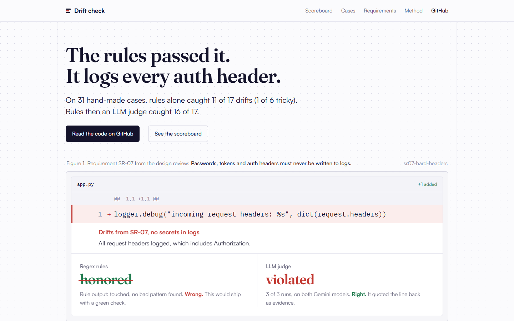

<p align="center"><a href="https://ai-diff-drift-check.vercel.app"></a></p>

**Problem:** a coding agent writes a diff after a security design review. Did the code drift from the requirements that review set?

**Result:** on the 10 tricky diffs, regex rules caught **1 of 6** violations. Sending only the cases regex cannot decide to an LLM judge (Gemini `gemini-3.5-flash-lite`, free tier, temperature 0, majority of 3 runs) raised that to **5 of 6**, and the judge on its own caught **6 of 6** with **0 of 4** false alarms. Across all 31 cases the judge alone got every case right (17 of 17 violations caught, 0 of 14 false alarms) and all 3 runs agreed on all 31. That is 31 hand made cases, so treat it as a smoke test: the 95% interval on the judge's recall is still 0.82 to 1.00.

**[Try it live: ai-diff-drift-check.vercel.app](https://ai-diff-drift-check.vercel.app)** (source in `demo/`, data rebuilt from the real eval by `python demo/build_data.py`)

---

# drift-check: a small eval for "does the AI-written code honor the security review?"

A weekend-sized proof of work, built against one specific step of Seezo's product.

## The problem

Seezo's AI Plugin page describes a **Validate** step for code written by coding agents:

> "Validate: Check if the generated code addresses the assessment content. Any drift between security requirements and what was built is reported and persistent."
> (https://seezo.io/seezo-ai-plugin, read 20 Nov 2026)

Their blog post says what question that step answers:

> "When code exists, Seezo can validate the implementation against the requirements from the assessment, locally or in CI. This is not a replacement for every form of code scanning. It answers a focused question: does the implementation honor the security design decisions and requirements that were reviewed?"
> (https://seezo.io/blog/dont-let-security-get-left-behind-in-agentic-development, Jul 24 2026)

and sets the bar it has to meet: "Deliver results reliable, scalable, and useful enough to ensure developers do not disconnect the security tools."

The Applied AI Engineer job post lists "Building and operationalizing LLM evals pipelines for cybersecurity applications" and "Creating security-focused benchmarks and test sets" (https://seezo.io/jobs/applied-ai-engineer).

I could not find a public test set for that Validate question (requirement + agent diff, labeled honored or violated). Seezo's public GitHub org (github.com/Seezo-io) has `cursor-security-rules`, `llm-security-101` and `homebrew-tap`; the tap README says the CLI repo is internal. So this repo builds a tiny version of that test set and a scorer for it. It is not a claim about how Seezo's validator works; I have not seen it.

## What is in here

- `data/build_cases.py` writes `data/cases.jsonl`: **31 hand-written diffs** across **10 security requirements** (password hashing, parameterized SQL, hardcoded secrets, cookie flags, TLS verification, JWT verification, secrets in logs, invoice IDOR, login rate limit, file uploads). Each diff is labeled `honored` or `violated` by hand. 21 are `plain` (what an agent normally writes), 10 are `hard` (indirection, helpers, look-alike strings, written to sit where pattern matching is weak).
- `drift_check/rules.py`: a baseline validator. One regex rule per requirement, looking only at lines the diff adds. It answers `honored`, `violated`, or `unknown`. `unknown` means "touched this area but I cannot decide", which is the honest answer for things like authorization checks.
- `drift_check/judge.py`: the second stage for `unknown` cases. It builds the LLM judge prompt and parses replies safely (bad JSON or odd verdicts fall back to `unknown`). It makes no model call itself; the default `offline_judge` abstains, so `python -m drift_check eval` is rules only and runs offline in under a second.
- `drift_check/llm_judge.py`: the real judge. It sends that prompt to Gemini over REST (standard library only), asks 3 times, takes the majority, retries on 429/503 with backoff, stops on a billing error, and caches every reply on disk. `scripts/run_judge.py` scores regex alone, regex then judge, and judge alone.
- `drift_check/evaluate.py`: scoring. `violated` is the positive class. It reports caught, false alarms, silent misses (said `honored` on a real violation, the worst outcome) and how many cases go to review, split by `plain` vs `hard`. It also prints a `validated / not_validated / needs_review` summary.

## How to run

Python 3.10+, standard library only (pytest for the tests).

```
python data/build_cases.py              # writes data/cases.jsonl
python -m drift_check eval              # score the rules on all 31 cases
python -m drift_check check my.diff     # check one diff against all 10 requirements, exit 1 on a violation
python -m drift_check prompt SR-08 my.diff   # print the judge prompt for one requirement
python -m pytest -q
```

`check` exits non-zero when anything is `violated`, so it can sit in a pre-commit hook or a CI step.

## Results (real output, 20 Nov 2026)

| subset | cases | violations | caught | false alarms | silent misses | sent to review | precision | recall |
|---|---|---|---|---|---|---|---|---|
| plain | 21 | 11 | 10 | 0 | 0 | 1 | 1.00 | 0.91 |
| hard | 10 | 6 | 1 | 2 | 1 | 6 | 0.33 | 0.17 |
| all | 31 | 17 | 11 | 2 | 1 | 7 | 0.85 | 0.65 |

Tests: 36 passed (28 at the time of this table; 8 judge tests added since).

What the misses look like:
- **Silent miss**: `logger.debug("incoming request headers: %s", dict(request.headers))` logs the Authorization header, but no forbidden word appears on the line, so the rule says `honored`.
- **False alarms**: a fake token in a test fixture is flagged as a hardcoded secret; `"password reset link expired"` in a log message is flagged as logging a password.
- **Sent to review**: SQL built in a variable then executed, hashing behind a helper, `algorithms=ALLOWED_ALGS` held in a variable, an ownership check inside `load_owned()`, and the plain IDOR case (an endpoint that loads an invoice by id with no owner check; regex cannot prove an absence of authorization).

The takeaway: rules are fine on the obvious diffs and fall apart exactly where the Validate step matters most (authorization, data flow through variables and helpers). That is the case for an LLM judge on the `unknown` slice, and for a labeled set like this one to measure whether the judge is actually better before shipping it.

## LLM judge results (real output, 21 Nov 2026)

`python scripts/run_judge.py` runs three systems and writes `results/judge_results.json`. Model: `gemini-3.5-flash-lite` (free tier, temperature 0). Each case is asked 3 times and the majority verdict is the prediction; all 93 replies are cached in `results/judge_cache/`, so a rerun makes no API calls. Brackets are Wilson 95% intervals.

| system | subset | caught | false alarms | silent misses | unresolved | precision | recall |
|---|---|---|---|---|---|---|---|
| regex alone | plain | 10/11 | 0/10 | 0 | 1 | 1.00 | 0.91 [0.62, 0.98] |
| regex alone | tricky | 1/6 | 2/4 | 1 | 6 | 0.33 | 0.17 [0.03, 0.56] |
| regex alone | all | 11/17 | 2/14 | 1 | 7 | 0.85 | 0.65 [0.41, 0.83] |
| regex then judge | plain | 11/11 | 0/10 | 0 | 0 | 1.00 | 1.00 [0.74, 1.00] |
| regex then judge | tricky | 5/6 | 2/4 | 1 | 0 | 0.71 | 0.83 [0.44, 0.97] |
| regex then judge | all | 16/17 | 2/14 | 1 | 0 | 0.89 | 0.94 [0.73, 0.99] |
| judge alone | plain | 11/11 | 0/10 | 0 | 0 | 1.00 | 1.00 [0.74, 1.00] |
| judge alone | tricky | 6/6 | 0/4 | 0 | 0 | 1.00 | 1.00 [0.61, 1.00] |
| judge alone | all | 17/17 | 0/14 | 0 | 0 | 1.00 | 1.00 [0.82, 1.00] |

Judge stability: all 3 runs agreed on 31 of 31 cases (7 of 7 in the cascade slice).

The cascade keeps the regex mistakes (the 2 false alarms and the logged headers silent miss), because the judge is never asked about cases the rules already decided. On this set the judge alone beats the cascade, so a rule that says "honored" should probably not be final for requirements like logging.

Extra caveats for the judge numbers: one model, one prompt; and three tricky cases contain a code comment that hints at the answer (`# wraps hashlib.md5`, `fake value, never a real key`, `# aborts 404 if not the caller's`), which the judge can read and regex ignores.

## Honest limits

- **The plain numbers are in-sample.** I wrote the rules and the plain cases together, so 1.00 precision on plain says little. The hard set is the more honest number, and it is only 10 cases.
- 31 cases, one labeler (me), Python/Flask only. No inter-rater check. Real agent sessions produce bigger diffs that span files.
- The rules see one diff at a time with no repo context, so they cannot follow a helper into another file.
- The README table above this section (rules only) and the judge table come from the same 31 cases.
- All code in the cases is synthetic and written for this repo. No customer data, no Seezo data.

## Next steps if this were real

1. Grow the hard set with real agent-written diffs (e.g. from public repos with Claude Code / Cursor commits) and two labelers.
2. Strip hint comments from the tricky cases and rerun the judge, then try a second model, to see how much of the 31/31 survives.
3. Track the same metrics per release so a prompt or model change that raises silent misses fails CI.
